# Appflow: pgbridge
Doc owner: Sowad Al-Mughni
Status: Draft
Last updated: 2026-05-12
Companion docs: PRD (01), Feature Spec (02), Technical Architecture (03), TRD (04), Backend Schema (05), UI/UX Design (06)

This document maps end-to-end flows through pgbridge. Three classes of flow:

1. **User journeys**: what humans do, step by step (developer installing, security engineer reviewing, auditor exporting).
2. **Request flows**: what happens inside pgbridge when an agent invokes a tool.
3. **Operational flows**: deployment topologies, recovery, multi-tenant boundaries.

Diagrams use Mermaid so they render on GitHub and in most markdown viewers. Each flow ties back to numbered features in the Feature Spec and requirements in the TRD.

---

## 1) User journey: first install (developer)

Target time-to-first-query: under 10 minutes for someone who knows their schema.

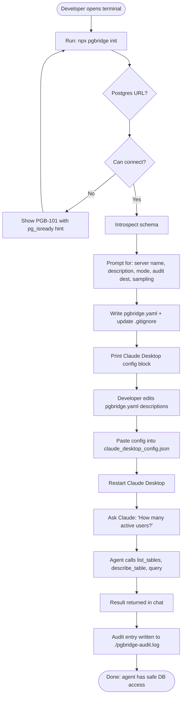

### Decision points and time budget

| Step | Time | Failure mode | Recovery |
|---|---|---|---|
| `pgbridge init` invocation | 2s | None | - |
| Postgres connection | 1-3s | PGB-101 | Show `pg_isready` hint |
| Schema introspection | 1-10s (size-dependent) | Slow query | Warn at 5s, continue |
| Wizard prompts (6 questions) | 60-90s | Bad input | Re-prompt with hint |
| YAML write | <1s | Permission denied | Suggest `--out` flag |
| Manual annotation pass | 5-25min (developer's choice) | Skipped | Agent sees TODOs |
| Claude Desktop config paste | 30s | Bad path | Validate path on next start |
| First agent query | 10-30s | Tool not registered | Verify config block syntax |

Total minimum: ~5 minutes (skip annotations).
Recommended: 10-15 minutes (light annotation pass).

---

## 2) User journey: daily developer work

The developer iterates on schema and annotations while the agent runs.

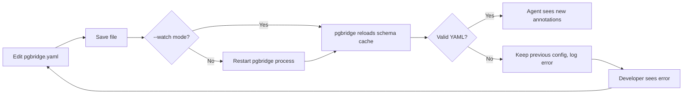

Validate-before-restart is a power user move:

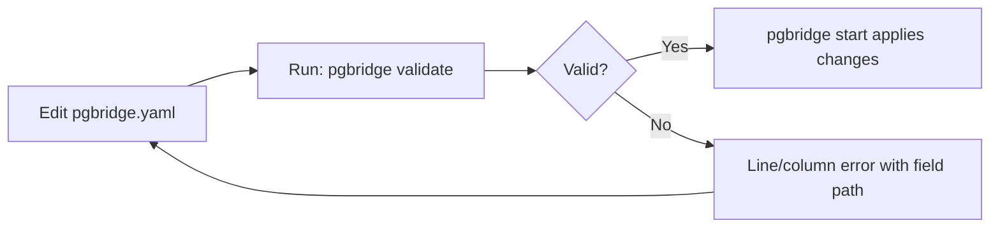

---

## 3) User journey: security review

The security engineer is gating production deployment. They never run pgbridge themselves; they read.

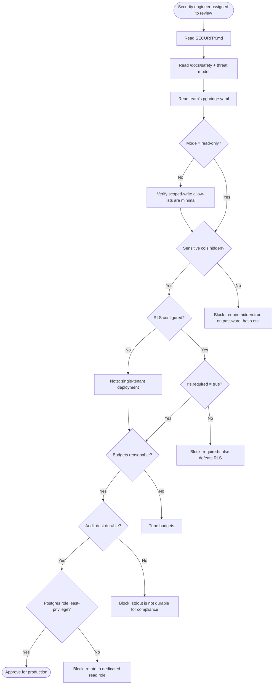

### Review checklist (artifact for the engineer)

| Item | Pass criterion |
|---|---|
| Mode | read-only OR scoped-write with explicit per-table allow-list |
| Sensitive columns | All PII/secrets marked `hidden: true` or `sensitive: high` |
| RLS | `rls.required: true` for multi-tenant; `session_variables` named |
| Budgets | `max_rows`, `max_query_ms`, `max_columns`, `max_payload_bytes` all set |
| Audit destination | file (with rotation), postgres, or s3 (not stdout for prod) |
| Audit redaction | `redact_fields` covers org-specific PII tokens |
| Postgres role | Dedicated read role; no superuser; only-needed grants |
| Network exposure | pgbridge runs as sidecar or behind agent host, not internet-exposed |
| Dependency review | npm audit clean; license check pass |
| SECURITY.md acknowledged | Engineer reads disclosure process |

---

## 4) User journey: auditor compliance query

A SOC 2 auditor asks: "Show me every query the AI agent ran on tenant tnt_abc in March 2026."

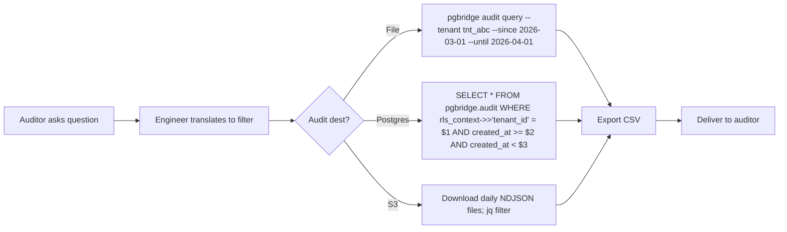

A well-configured pgbridge produces an export in under 5 minutes regardless of destination.

---

## 5) Request flow: a single `query` tool call

This is the canonical request lifecycle, expanded from Tech Arch §3.

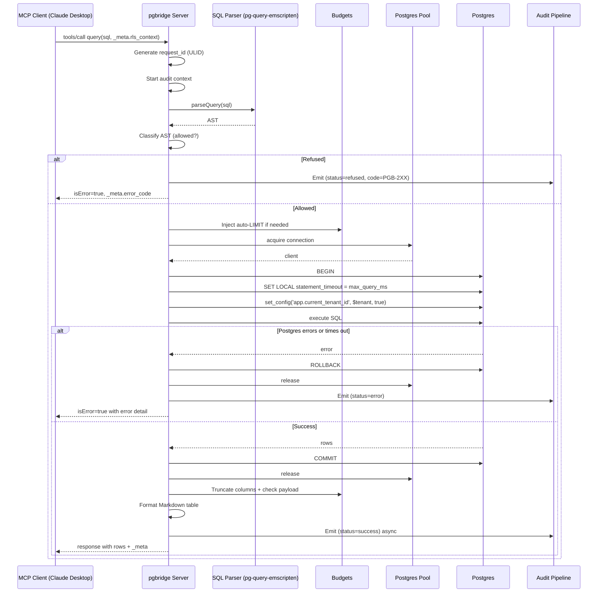

### Step-by-step with TRD links

| Step | TRD requirements engaged |
|---|---|
| Request received via stdio | IR-MCP-01, FR-PROTO-01 |
| request_id generated | IR-AUDIT-03 |
| SQL parsed via WASM parser | SEC-INJECT-01, FR-READ-08 |
| AST classified | FR-READ-01 through FR-READ-06 |
| Auto-LIMIT injected | FR-BUDGET-01 |
| BEGIN, SET LOCAL, query, COMMIT | FR-RLS-01, FR-RLS-05, SEC-INJECT-02, SEC-ESCAPE-01 |
| Statement timeout | FR-BUDGET-03 |
| Column truncation | FR-BUDGET-05 |
| Payload check | FR-BUDGET-06 |
| Audit emit | FR-AUDIT-01, FR-AUDIT-03 |
| Response shape | IR-MCP-03, IR-MCP-04 |

---

## 6) Request flow: refusal paths

Every refusal short-circuits before Postgres is touched. The refusal flow itself must be cheap (sub-millisecond budget excluding parse).

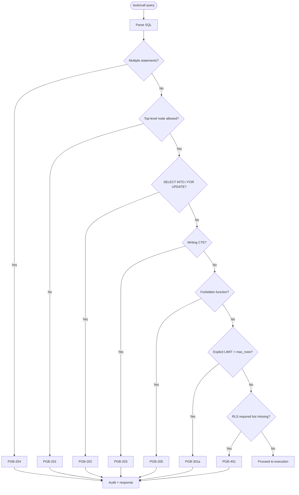

### Latency budget for refusals

| Path | Target p95 |
|---|---|
| Refused on parse error | <1ms |
| Refused on AST classification | <5ms |
| Refused on RLS missing | <2ms (no parse needed) |
| Refused on budget (LIMIT > max) | <5ms (parse + check) |

---

## 7) Request flow: schema discovery (`describe_table`)

Schema discovery is cache-hot most of the time. Cold path runs on startup.

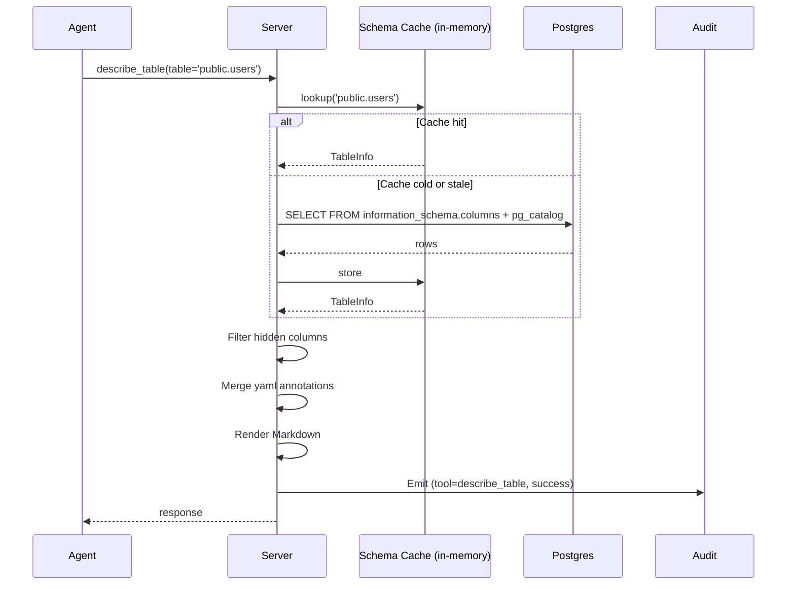

### Cache invariants

| Invariant | How enforced |
|---|---|
| Hidden tables never exit the cache layer | Filtered at cache build time, not at render time |
| Hidden columns never exit the cache layer | Same |
| TTL 60s default | Background refresh task |
| Manual reload via --watch | YAML file mtime triggers rebuild |
| Stale yaml (table missing from DB) | Logged warning, served from cache with "no longer exists" indicator |

---

## 8) Audit pipeline flow

Audit is the cross-cutting concern. Every tool call hits it. The pipeline must never block the request path.

```mermaid
flowchart LR
    subgraph Request path
      Tool[Tool handler] --> Emit[audit.emit redacted entry]
      Emit --> Done[Return to caller]
    end

    subgraph Async (separate task)
      Queue[(In-memory queue<br/>10MB max)] --> Loop[Flush loop<br/>every 100ms]
      Loop --> Batch[Batch entries]
      Batch --> Stdout[stdout destination]
      Batch --> File[file destination]
      Batch --> PGAudit[postgres destination]
      Batch --> DD[datadog destination]
      Batch --> S3[s3 destination]
    end

    Emit -.enqueue.-> Queue

    Queue -. queue full .-> Alarm[stderr CRITICAL alarm<br/>entry dropped]
```

### Backpressure behavior

| Condition | Behavior |
|---|---|
| Queue under 50% full | Normal operation |
| Queue 50-80% full | Continue; metrics indicator turns yellow |
| Queue 80-100% full | Continue; warning logged once per 60s |
| Queue full + new entry | Drop entry; stderr CRITICAL alarm; never block caller |
| Destination unreachable for N retries | Mark destination unhealthy; continue trying with exponential backoff (cap 30s) |
| Destination becomes healthy | Resume normal flushing |

### Why fire-and-forget

The blocking alternative (block the query if audit cannot write) trades availability for completeness. For an MCP server sitting in front of a production database, availability matters more. Operators who require completeness either (a) use a durable destination with high uptime (Postgres on the same DB; S3; Datadog) or (b) monitor the CRITICAL alarm and stop the agent if audit cannot keep up.

---

## 9) Deployment flow: sidecar pattern (default)

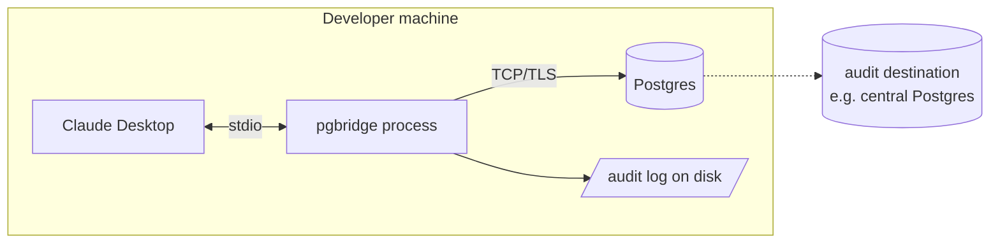

Used by: local development, internal tools, single-developer agent.

---

## 10) Deployment flow: production agent host

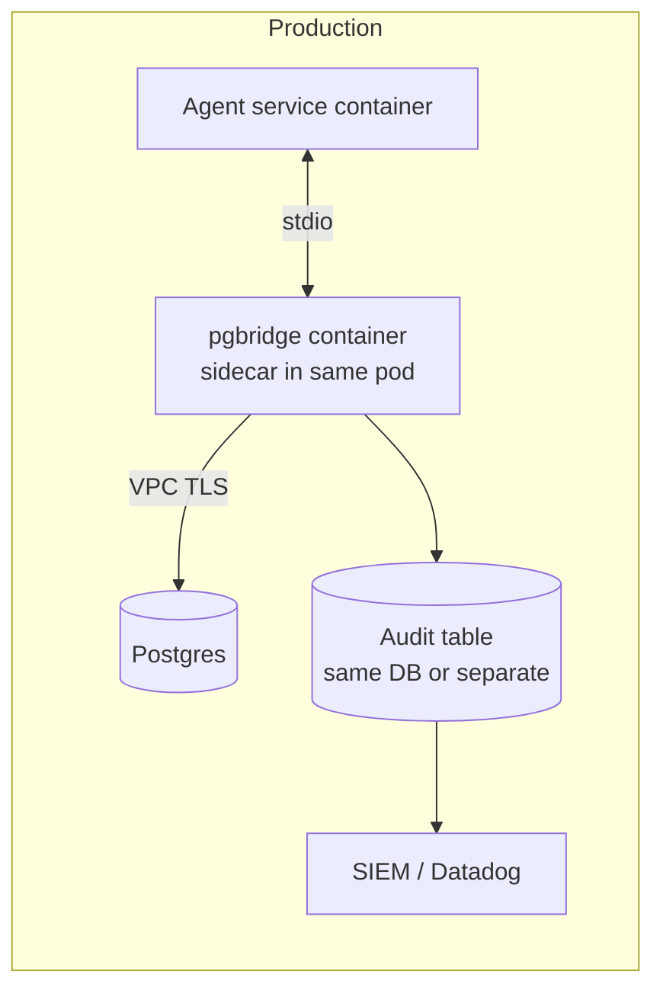

Notes:

- pgbridge runs as a sidecar in the same pod for stdio communication.
- Postgres role for pgbridge is read-only on user tables, INSERT-only on audit.
- A separate Postgres role is used by the audit destination, so a compromise of the query role cannot rewrite audit.

---

## 11) Deployment flow: multi-tenant SaaS

Two architectures, each with tradeoffs.

### A) One pgbridge instance per tenant

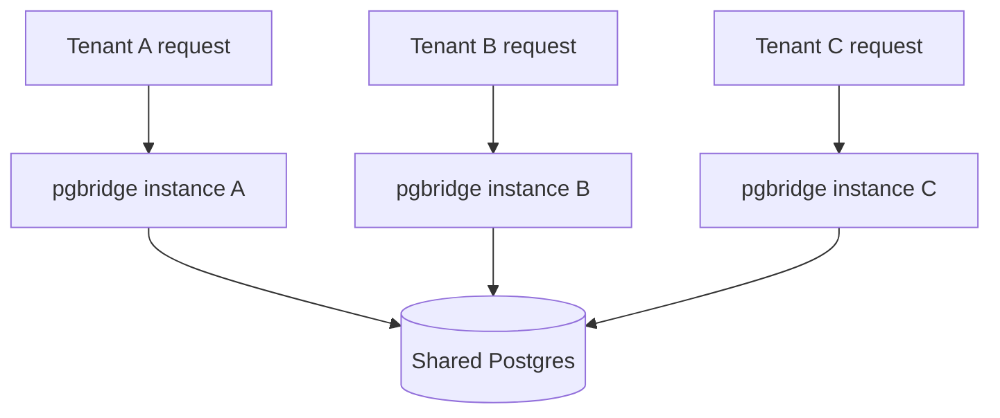

Pros: strongest isolation. Each tenant gets a process. Hostile-tenant blast radius is one process.
Cons: process-per-tenant capex; idle processes consume RAM.
Best for: enterprise plans, high-isolation requirements.

### B) Single pgbridge with per-request RLS context

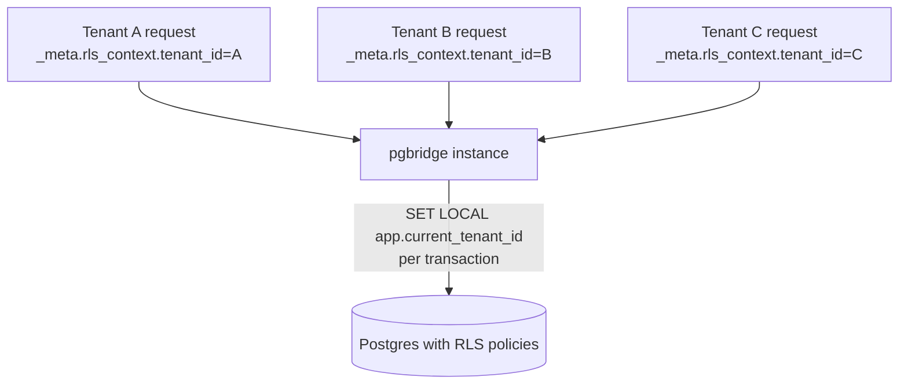

Pros: cheap; one process serves many tenants.
Cons: process compromise affects all tenants; depends on RLS correctness end-to-end.
Best for: free/starter tiers, low-isolation workloads, RLS-validated databases.

The product supports both. v1 ships pattern A as the documented default (safer); pattern B is documented as an advanced option with a `--multi-tenant` flag that requires `rls.required: true`.

---

## 12) Disaster recovery and failure flows

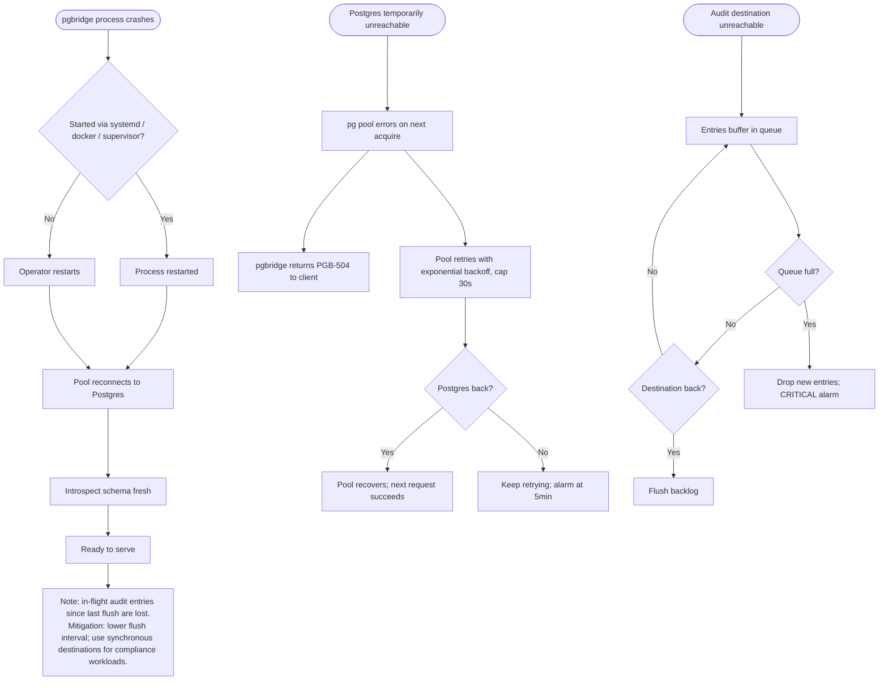

### What state is lost on crash

| State | Loss profile |
|---|---|
| Schema cache | Rebuilt on startup; cost: ~500ms for 100 tables |
| Audit queue (unflushed) | Lost (default 100ms flush window; ≤100ms of activity max) |
| In-flight queries | Postgres rolls back uncommitted transactions; client sees disconnect |
| Connection pool | Recreated; ~50ms cold start |
| Audit destinations | Reopened; file appended; Postgres reconnected |

---

## 13) End-to-end data flow

How a developer's question becomes a row in the audit table.

```mermaid
flowchart TD
    Dev[Developer asks Claude:<br/>'How many active users?'] --> Claude[Claude composes plan]
    Claude --> Tool1[Calls list_tables]
    Tool1 --> Pgbridge1[pgbridge returns annotated table list]
    Pgbridge1 --> Audit1[(audit row: tool=list_tables, status=success)]
    Pgbridge1 --> Claude
    Claude --> Tool2[Calls describe_table users]
    Tool2 --> Pgbridge2[pgbridge returns column-level schema]
    Pgbridge2 --> Audit2[(audit row: tool=describe_table)]
    Pgbridge2 --> Claude
    Claude --> Tool3[Calls query<br/>SELECT count(*) FROM users<br/>WHERE deleted_at IS NULL]
    Tool3 --> Parser[Parse SQL]
    Parser --> Classify{Allowed?}
    Classify -- Yes --> Exec[Execute with budgets + RLS]
    Exec --> Result[Result: 1 row, 1 column, 23ms]
    Result --> Audit3[(audit row: tool=query, rows=1, ms=23)]
    Result --> Claude
    Claude --> Display[Display: '847 active users']
    Display --> Dev
```

This one user prompt produces three audit rows. Each row is independently searchable and exportable. The auditor can reconstruct exactly what the agent saw, how it got there, and what it answered with.

---

## 14) v1.5 cloud user journey (sketch)

For forward planning only.

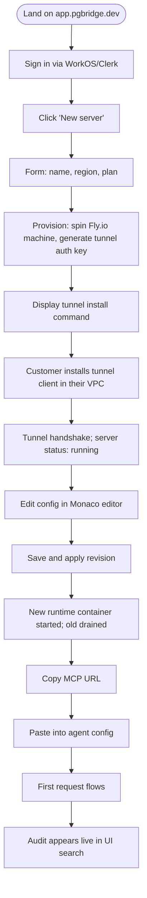

---

## 15) Trace identifiers

Every event in the system can be correlated through these IDs.

| ID | Scope | Created at | Used by |
|---|---|---|---|
| `request_id` (ULID) | One MCP tool call | When server.setRequestHandler receives the call | Audit log, error responses, agent logs |
| `session_id` (ULID) | One MCP session (from initialize to shutdown) | At MCP initialize handshake | Audit log; "walk a session" debugging |
| `trace_id` (W3C, optional) | OpenTelemetry distributed trace | When `--otel` flag set | Datadog, Tempo, Honeycomb |
| `tenant_id` (string) | Per-request from `_meta.rls_context` | By the MCP client/host | Audit log, RLS variable |
| `pgbridge_version` | Per-process | At binary build | Audit log |
| `server_name` | Per-config | From `server.name` in YAML | Audit log; identifies which pgbridge for multi-server deployments |

Audit log entries always include `request_id`, `session_id`, `tenant_id` (if present), `pgbridge_version`, `server_name`. Distributed-trace IDs (W3C `traceparent`) are included when OTEL is enabled.

---

## 16) Open issues

| ID | Question | Owner | Due |
|---|---|---|---|
| AF-01 | Multi-tenant pattern B (single process + per-request RLS): ship the `--multi-tenant` flag in v1 or v1.1? Current: v1.1; v1 documents pattern A only to keep the safety message clear. | Sowad | 2026-05-13 |
| AF-02 | Should the request flow include an optional pre-execution `EXPLAIN` gate when query estimated rows exceed a threshold? Adds a roundtrip; opt-in via `budgets.explain_before_execute: true`. | Sowad | 2026-05-20 |
| AF-03 | Should pgbridge expose a `tools/list` health-check tool the operator can invoke from a TUI? Helpful for SREs; out of MCP norm. Defer to v1.1. | Sowad | v1.1 |
| AF-04 | Cancel-mid-query: best-effort `pg_cancel_backend` or wait for statement_timeout? Current: best-effort cancel on disconnect; documented as best-effort. | Sowad | 2026-05-15 |
