# Appflow: pgmoat

Doc owner: Sowad Al-Mughni (Kitalon Labs)
Status: Draft v2 (supersedes pgbridge Appflow v1)
Last updated: 2026-10-17
Companion docs: 01 PRD, 02 Feature Spec, 03 Technical Architecture, 06 UI/UX Design

End-to-end flows for pgmoat: human journeys, request flows inside the server, and deployment topologies. Diagrams are Mermaid (render on GitHub). Each flow names the features (F#) and requirements (R#) it exercises.

---

## 1) Journey: first install in Claude Desktop (MCPB)

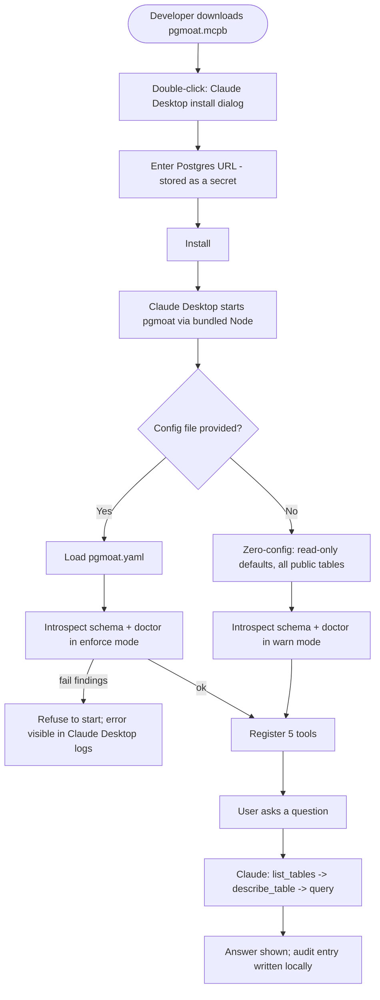

Target: under 3 minutes, no terminal. Features: F1, F4, F7, F11, F14, F19. Requirements: R1, R9, R23.

---

## 2) Journey: Claude Code or another client (npx)

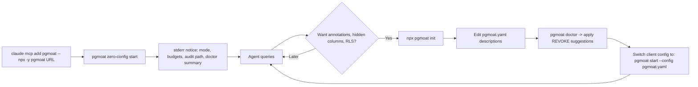

---

## 3) Journey: migrating from the archived reference server

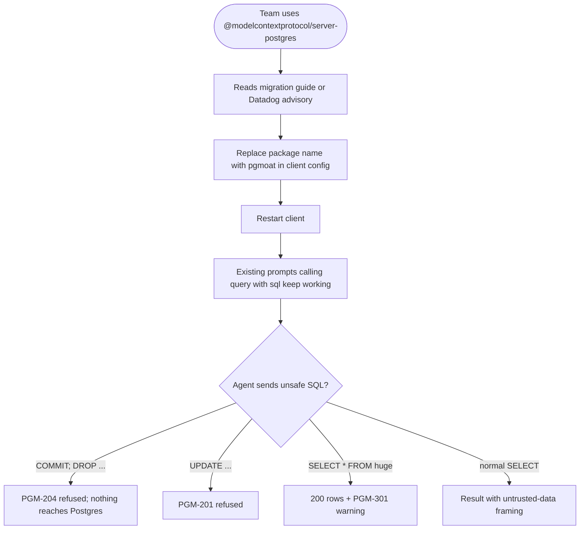

Requirement: R23. The migration guide also lists behavior differences: row cap, catalog refusal, structured output.

---

## 4) Journey: security review

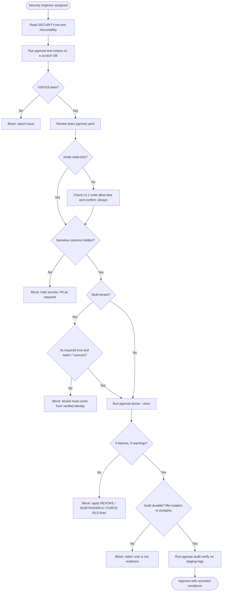

### 4.1 Review checklist

| Item | Pass when |
|---|---|
| Mode | `read-only` (v1.0) |
| Hidden columns | Every secret and regulated field is `hidden: true` |
| Role | `pgmoat doctor --strict` exits 0 |
| RLS | `required: true` with `token.*` (HTTP) or `env.*`/`static:` (single tenant) sources; protected tables listed |
| Catalog access | `allow_catalog_queries: false` |
| Budgets | Defaults or tighter |
| Transport | stdio, or HTTP with OAuth and allowed hosts |
| Audit | File with retention or Postgres with append-only role; `verify` passes |
| Redaction | `redact_fields` covers org-specific secret names |
| Agent tool mix | No outbound-capable tools combined with sensitive data in the same agent, or a documented exception |
| Corpus | 100% on the team's Postgres version |

---

## 5) Journey: auditor request

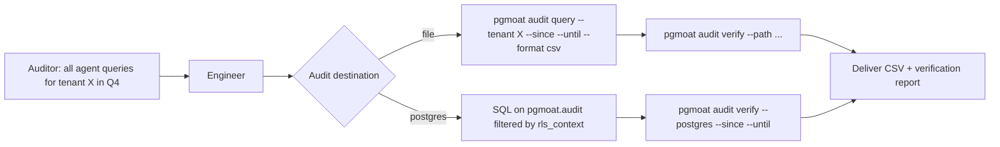

---

## 6) Request flow: `query` over stdio

```mermaid
sequenceDiagram
    autonumber
    participant C as MCP client
    participant S as SDK v2 (serveStdio)
    participant T as run-tool
    participant R as rls/resolve
    participant P as safety pipeline
    participant X as postgres/execute
    participant DB as Postgres
    participant A as audit

    C->>S: tools/call query {sql} (_meta envelope)
    S->>T: handler(args, ctx)
    T->>T: RequestContext (request_id, client, principal=local, trace)
    T->>R: resolve session variables (env/static/trusted meta)
    alt required value missing
        R-->>T: PGM-401/403/404
        T->>A: emit refused
        T-->>C: isError result
    end
    T->>P: parse -> classify -> policy -> rewrite -> re-check
    alt refused
        P-->>T: PGM-2xx / PGM-302
        T->>A: emit refused
        T-->>C: isError result
    end
    T->>X: executeRead(sql, rls, budgets, signal)
    X->>DB: BEGIN READ ONLY
    X->>DB: set_config statement_timeout, lock_timeout, idle timeout (local)
    X->>DB: set_config RLS variables (local, bound params)
    X->>DB: Parse/Bind/Execute via cursor, read max_rows+1
    alt timeout / error
        DB-->>X: 57014 / error
        X->>DB: ROLLBACK; destroy connection
        X-->>T: PGM-303 / sanitized error
        T->>A: emit error
        T-->>C: isError result
    end
    X->>DB: COMMIT
    X-->>T: rows, fields
    T->>T: budgets (rows, columns, cells, payload) + output (structured + framed text)
    T->>A: emit success (redact, chain, enqueue)
    T-->>C: result (structuredContent + text)
```

---

## 7) Request flow: safety pipeline decisions

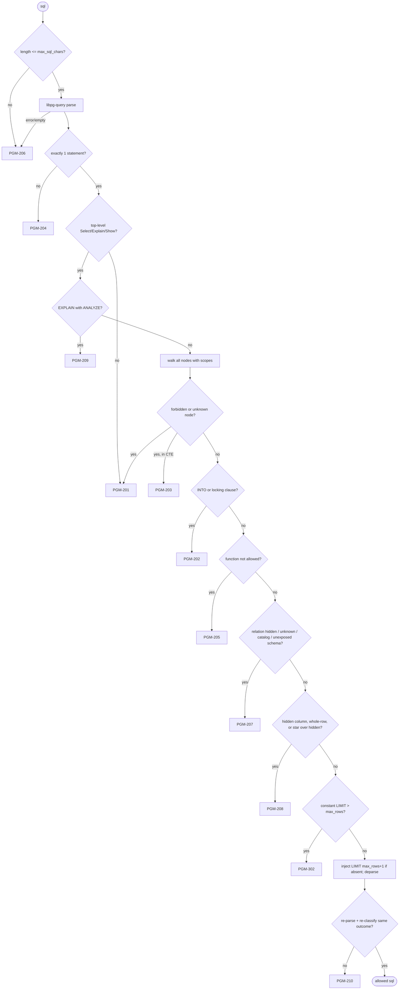

Refusal latency target: under 3 ms p95 (no database contact).

---

## 8) Request flow: HTTP with OAuth

```mermaid
sequenceDiagram
    autonumber
    participant U as End user
    participant H as Agent host (MCP client)
    participant IdP as Identity provider
    participant G as pgmoat (HTTP)
    participant DB as Postgres

    H->>G: POST /mcp (no token)
    G-->>H: 401 WWW-Authenticate: Bearer resource_metadata=".../.well-known/oauth-protected-resource", scope="pgmoat:read"
    H->>G: GET /.well-known/oauth-protected-resource
    G-->>H: { resource, authorization_servers:[IdP], scopes_supported }
    H->>IdP: OAuth 2.1 + PKCE, resource=<pgmoat URL>
    U->>IdP: sign in, consent
    IdP-->>H: access token (aud=pgmoat URL, tenant_id claim)
    H->>G: POST /mcp tools/call query, Authorization: Bearer ...
    G->>G: verify JWT (JWKS, iss, aud, exp, scope) -> Principal
    G->>G: RLS: app.tenant_id <- token.tenant_id
    G->>DB: BEGIN READ ONLY; set_config(...); cursor query; COMMIT
    G-->>H: result
    H-->>U: answer
```

Failure paths: wrong audience or expired token gives 401 (PGM-601); missing scope gives 403 `insufficient_scope` (PGM-602); token without `tenant_id` and `required: true` gives a tool error PGM-405 (HTTP 200 with `isError`, because auth succeeded but context is incomplete).

---

## 9) Audit pipeline

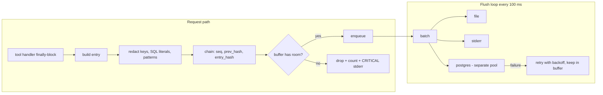

| Buffer state | Behavior |
|---|---|
| Under 80% | Normal |
| 80% to 100% | Warning to stderr once per minute |
| Full | Drop new entries, increment counter, CRITICAL once per minute; next written entry carries `dropped_since_last` |
| Destination recovers | Backlog flushes in order |

---

## 10) Deployment: local sidecar (default)

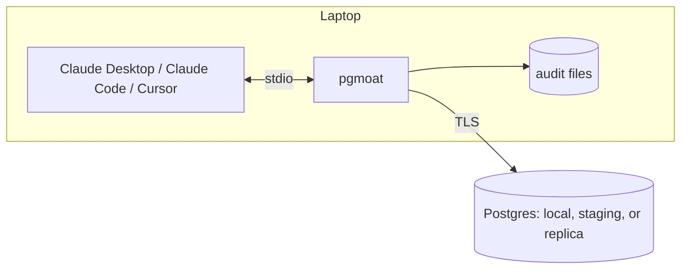

---

## 11) Deployment: production agent sidecar

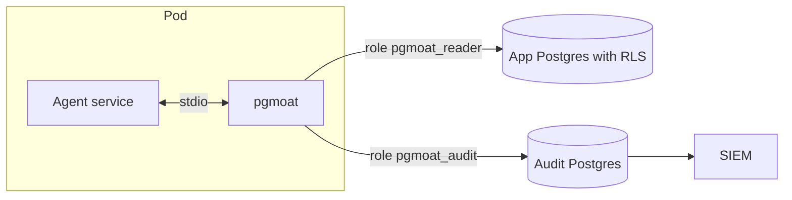

RLS source: `env.TENANT_ID` (one tenant per pod) or `meta.*` with `trust_request_meta: true` (the agent service sets the tenant per request and is the trust boundary).

---

## 12) Deployment: multi-tenant gateway

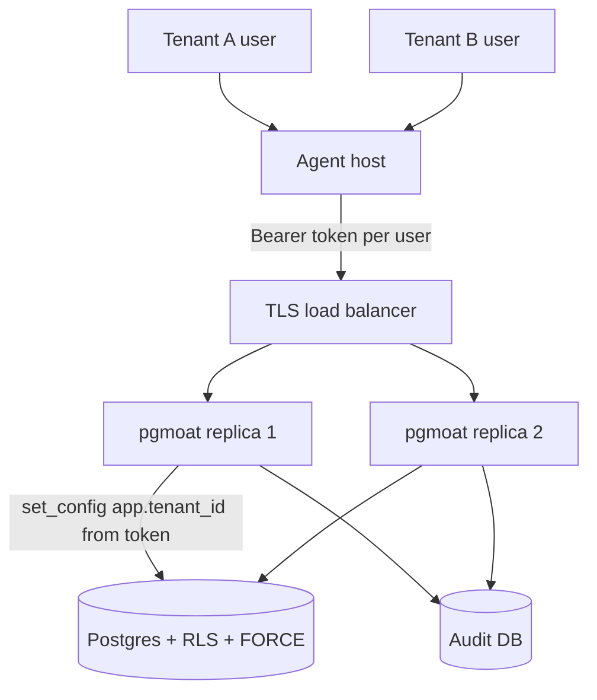

pgmoat is stateless, so replicas scale horizontally behind any load balancer without session affinity (the 2026-07-28 protocol has no sessions).

Alternative for strict isolation: one pgmoat per tenant with `static:` RLS values or a per-tenant database role.

---

## 13) Failure and recovery

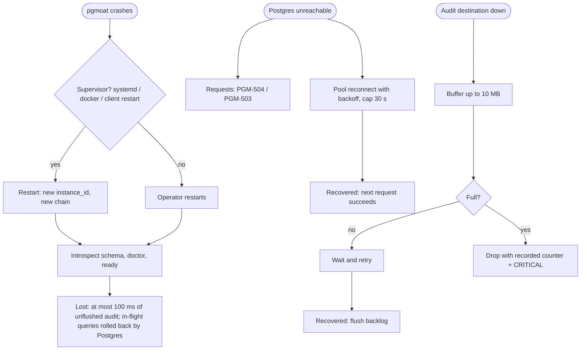

| State | Loss on crash |
|---|---|
| Schema cache | Rebuilt at start (under 1 s for 100 relations) |
| Audit buffer | At most one flush interval (100 ms) |
| In-flight queries | Rolled back by Postgres; client sees an error |
| Audit chain | New chain per instance; `verify` handles many instances |

---

## 14) End-to-end example

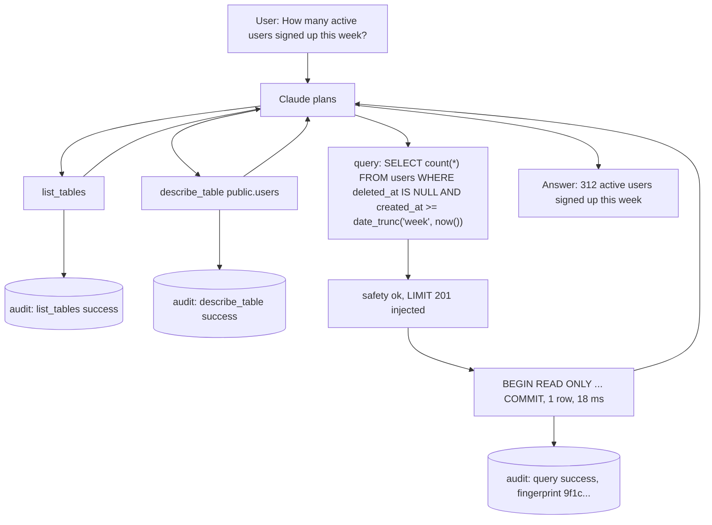

Three tool calls, three chained audit entries. An auditor can reconstruct exactly what the agent saw and did.

---

## 15) Identifiers

| ID | Scope | Created | Used in |
|---|---|---|---|
| `request_id` (ULID) | One tool call | `run-tool.ts` | Result `_meta`, audit, logs |
| `instance_id` (ULID) | One process start | `runtime.ts` | Audit chain grouping |
| `seq` | Per instance | Audit chain | Ordering and gap detection |
| `principal` | Per request | `auth.ts` (token `sub`) or `local` | Audit |
| `trace_id` | Per request (optional) | Client `traceparent` in `_meta` | Audit, OpenTelemetry (v1.1) |
| `client_name/version` | Per request (self-reported) | `_meta` envelope | Audit (display only) |
| `sql_fingerprint` | Per query shape | `fingerprint.ts` | Audit pattern analysis |

There is no session ID. The 2026-07-28 protocol has no sessions, and a stdio process is not a conversation.

---

## 16) Open issues

| ID | Question | Lean |
|---|---|---|
| AF-01 | Expose `/metrics` in v1.0 for the gateway pattern? | v1.1 |
| AF-02 | Optional pre-execution EXPLAIN gate for high estimated cost? | v1.2, opt-in |
| AF-03 | Return PGM-405 as a tool error (current) or HTTP 403? | Tool error: auth succeeded, context is incomplete |
